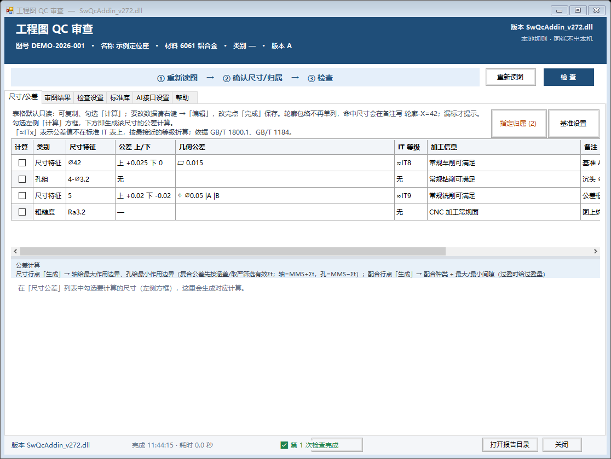
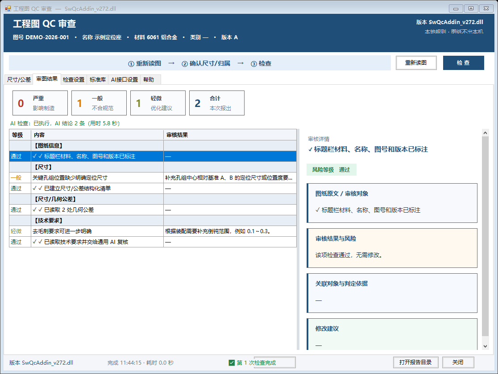
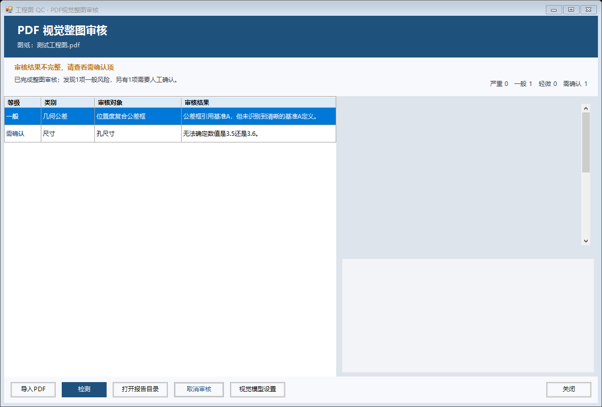
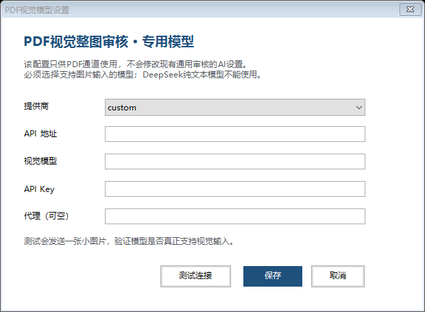

# SW 工程图 AI 审核插件

面向机械设计工程师的 SOLIDWORKS 工程图审核工具。插件以 **SOLIDWORKS 原生工程图审查** 为主功能：读取标题栏、技术要求、尺寸/公差、几何公差、粗糙度等信息，先执行本地规则检查，再把结构化结果交给通用 AI 做语义复核，输出风险等级、判断依据和修改建议。

> 当前公开版本：v272。软件用于辅助发现风险，不能代替设计签字、工艺会签、标准原文或检验判定。

## 核心能力

- 原生读取 SOLIDWORKS 工程图信息，不依赖截图 OCR 作为主流程。
- “尺寸/公差”列表是插件内其他窗口及 AI 审核的统一数据来源。
- 检查尺寸公差、几何公差、基准关联、粗糙度、标题栏和技术要求。
- 本地规则库与通用 AI 语义检查协同工作。
- 审核结果保持简明：风险等级、审核对象、结论、依据、建议。
- 支持人工修正归属关系，再基于修正后的统一数据重新审核。
- 提供 PDF 视觉整图审核作为补充通道，适用于没有 SOLIDWORKS 原始图纸的场景。

## 主界面

### 1. 重新读图并确认尺寸/公差

### 2. 执行规则与 AI 审核

推荐工作顺序：**重新读图 → 确认尺寸/归属 → 检查**。

## PDF 补充通道

PDF 通道把整页图纸渲染后交给用户自行配置的视觉模型，适合作为原生审图的补充，不是本产品的主通道。

查看 PDF 通道界面

## 快速开始

1. 阅读 [安装说明](docs/INSTALL.md)。
2. 阅读 [操作手册](docs/USER_GUIDE.md)。
3. 查看 [兼容性表](docs/COMPATIBILITY.md) 和 [隐私说明](PRIVACY.md)。
4. 遇到问题请在 GitHub 的 **Issues** 中提交，并先删除图纸、日志和截图里的机密信息。

## 源码与许可证

本仓库公开 v272 对应的 C# 插件源码、Python 审核引擎、规则文件及安装/构建脚本，采用 [GNU AGPL v3.0 或更高版本](LICENSE)。你可以使用、修改和再分发，但分发修改版或通过网络提供修改版服务时，需要继续遵守 AGPL 的源码提供等义务。

SOLIDWORKS API Interop 文件属于 SOLIDWORKS 安装内容，不在仓库中分发。第三方组件说明见 [THIRD_PARTY_NOTICES.md](THIRD_PARTY_NOTICES.md)。

## 购买与服务

源码公开不等于所有服务免费。可收费内容包括整理好的安装包、安装升级服务、规则定制、培训、优先维护和二次开发。具体边界及购买入口见 [PURCHASE.md](PURCHASE.md)。

## 项目文档

- [安装说明](docs/INSTALL.md)
- [操作手册](docs/USER_GUIDE.md)
- [兼容性表](docs/COMPATIBILITY.md)
- [架构与数据流](docs/ARCHITECTURE.md)
- [测试说明](docs/TESTING.md)
- [隐私说明](PRIVACY.md)
- [更新记录](CHANGELOG.md)
- [问题反馈与贡献](CONTRIBUTING.md)
- [安全说明](SECURITY.md)

